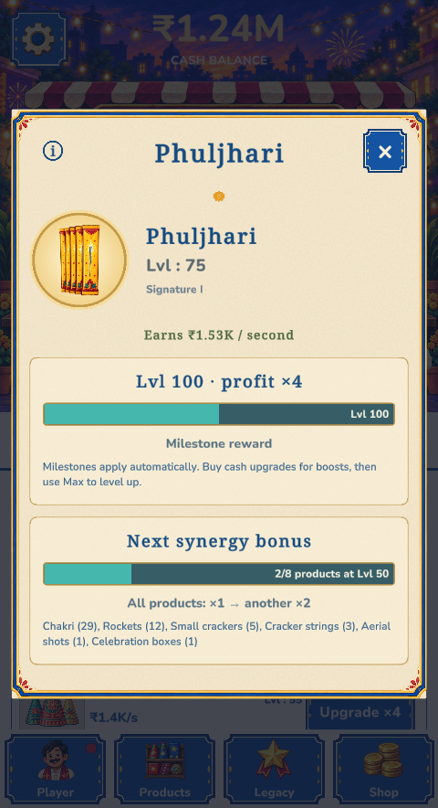
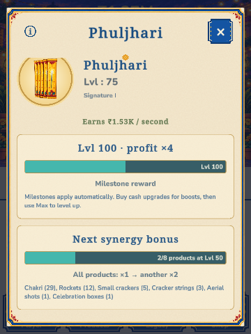

# Product overview native parity — 31 October 2026

The user approved the current HTML popup by selecting it in the browser and requesting the corresponding Unity popup. Reference: `UI Builder/HTML/Classic/index.html`, `classic.js` productDetail(), `popup-refresh.css`, `popup-clearance.css`, existing imported-button styles, and the selected 480×884 app capture. The browser fixture is presentation data; the native economy remains authoritative.

## Implementation

Destination: `Assets/Scenes/Main.unity`, `ClassicProductionCanvas/Local dialogs/ProductDetail`. The complete previous root is retained inactive beside it as `ProductDetail__LegacyDisabled_20261031`, including its components and serialized data. `ClassicUI.dialogs` and product text/image bindings now target the replacement. The initial saved state keeps both popup roots inactive. All UI, fallback text material slots, cards and controls exist in the saved scene. The Editor migration is `ClassicProductOverviewAuthoring`; no player UI construction was added.

The layout uses the unchanged production 360-unit CanvasScaler, mapping the reviewed 480px app by 0.75. Header, portrait and card spacing match the selected reference. Native text and rounded sprites approximate browser rasterization. The subtle card background uses a translucent cream sprite rather than the exact CSS diagonal gradient; the gold portrait uses a scoped radial-gradient sprite. The existing gold/cobalt frame, imported Folk Blue button, native serif/body/bold fonts, product art, guidance and navigation are reused. The body uses native preferred-height layout and scrolling when it overflows. The whole UI scales with the production canvas, so the full popup fits at 360×540; it scrolls at 360×480.

Live bindings cover all eight product identities, native Signature appearance, levels, income, milestone rewards, interval progress, synergy counts, missing products and multipliers. New capped-state bindings replace misleading milestone instructions with “Fully levelled” and the active-bonuses explanation. No prices, rewards or economy rules changed. Native entry/exit scale/fade, progress interpolation, input feedback, child-popup stacking and Reduced motion remain in use.

## Validation

[42 native checks](checks.txt) passed through production Bootstrap → Main using a newly generated temporary guest profile. Fixtures were committed through the existing engine/codec only inside that profile. The previous profile override was restored after Play Mode.

- Saved-scene references and all 294 popup components survive reload; both current and legacy popup start inactive.
- All eight product names, levels and income use engine values; Signature I art uses native progression.
- Zero stock, level 75 → 100 progress, 2/8 and 7/8 synergy, completed threshold advancement and maximum product/synergy states pass.
- All visible popup labels and the close glyph render without truncation.
- Information opens Guidance above the retained product popup; Back restores its interaction and opener focus.
- The saved close and outside-dismissal buttons work, including Reduced motion and closing during entry/reopening.
- Bounds pass at 480×884, 390×844, 360×540 and 360×480; the last size scrolls to the synergy explanation.
- Component instance identities remain unchanged across all interactions. No runtime errors, exceptions or assertions occurred during the final run.
- An additional safe-area check passed with a simulated 6% top notch, 4% bottom indicator and 2% side insets.
- Edit Mode checks confirmed the saved geometry at 480×884 and 360×480 without presentation initialization. The Editor Game View capture returned only its camera background outside Play Mode, so visual comparison uses the actual production Play Mode captures below.

No Android build, physical-device rendering, localization expansion or device accessibility pass was performed.

## Captures

The native income is ₹1.53K/sec for this temporary engine fixture, while the selected browser example showed ₹1.22K/sec. Displayed values deliberately follow the native engine rather than copying fixture text. Capture cash is also allowed to tick with automatic sales.

## Source and asset provenance

The initial broad package inventory identified broken relative links only in historic `parity/before` and review documents. An isolated copy of the current canonical entry points and shared dependencies passed inventory with no duplicate IDs, malformed metadata, missing local resources, missing Unity assets or asset-parity failures. No archived HTML was changed. Original and selected-package reports, backups and initial captures were kept outside the project during reconstruction.

The following verified static SVGs contain no scripts, handlers, foreign HTML or external loads. They were rasterized independently with transparency, not as a flattened screen:

| Source | SHA-256 | Output/use |
|---|---|---|
| `Home/assets/gouache-paper.svg` | `b58746766210e9858b3fd17da478e1861ce3687d85377b278266c0af4a3c6ce0` | `Assets/Game/ClassicUI/ProductOverview/paper.png`, 180×180 tiled overlay |
| `Shared/ivory/flower.svg` | `19adddab441938637d45948d50df6f5080ae326ccbe47a7b5109bd02a45bd6af` | `Assets/Game/ClassicUI/ProductOverview/flower.png`, 80×80 header ornament |

The Editor builder creates the scoped 256×256 gold portrait disc and 96×96 / 64×64 sliced card/progress surfaces from the selected CSS colors. Shared art, fonts, materials, import settings, camera, build settings and unrelated dirty work are preserved. A task-local pre-edit scene/file backup was used for scope comparison; Main was saved exclusively through the Unity Editor.
