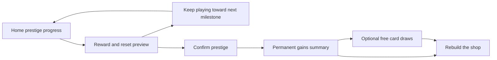

# Rocket Raja: prestige, Talent, and rebuild flow

**7 October 2026 — current design:** the user confirmed the Unity implementation as intended. [Current Implementation Design](Current%20Implementation%20Design.md) takes precedence over conflicting passages below. Unrestricted cash upgrades, unlimited manual taps, immediate global Buy All, Classic browsing without product filters/pins, disabled transient notices and 1×/5× pulls are accepted.

Updated: 1 October 2026. Planning only.

Cash-only progression is selected. [Economy Specification v1](Economy%20Specification%20v1.md) and the main catalogue contain the current prices and Fame formula, with no completed-prestige requirements for cash upgrades. The x6 opening bonus is retained. Numerical balance remains subject to prototype tuning; the [decision record](Cash-only%20Economy%20Alternative%20v1.md) preserves the superseded comparison.

This translates the selected prestige/card structure into a reviewable interaction flow. Confirmed mechanics are in [Redesign Working Plan](Redesign%20Working%20Plan.md); numerical candidates are in [Talent and Prestige Draft](Talent%20and%20Prestige%20Draft.md). The starting cash grant, manual first purchase, retained shop decorations, and rebuilt product displays are now confirmed. Layouts, presentation timing, and other detailed UX remain prototype defaults.

## From progress to an informed reset



Before eligibility, Prestige opens a progress view explaining the earnings requirement and its reward. When eligible, Home gains a persistent Ready state, not a modal demanding a reset. The progress view has both Prestige now and Continue run. Spending cash on upgrades does not reduce eligible earned cash in the current numerical proposal.

V1 uses earnings-based eligibility E>=T with T=min(1e36,1e10×1.5^N), fixed during each run. Show current progress and the next-run target. There is no all-eight ownership gate on prestige. Cash-only progression is selected: show deeper cash goals, with no completed-prestige unlock requirement.

## Prestige preview

```text
PRESTIGE
Run earnings: <earned> / <requirement>            <Ready or progress>

PERMANENT INCOME
Current multiplier <xA>  ->  After reset <xB>
<Proposed Fame gain and retained total, if that model is adopted>

FREE DRAWS
First prestige: 3
Later prestige: Run progress <n> + Lifetime upgrades <m> = <total>
<Next earnings milestone and next lifetime first-purchase milestone>

RESETS                         KEEPS
<clear short lists>             <clear short lists>

<Next-run target, if it changes under the eventual balance rule>
[Continue run]                                  [Prestige]
```

Use one currency notation for earned progress, eligibility, and next rewards. Expand abbreviated values on demand. The lifetime draw component uses different cash upgrades purchased at least once; the separate Fame candidate affects income only. If the current 4T bonus qualification is adopted, label the available but inactive catalogue bonus and its requirement. That qualification and the reward coefficients are still proposals, so this screen is data-driven in the design rather than hardcoding them as approved values.

Show the exact guaranteed income change before reset. Exclude unknown future card effects. The latest x6 opening choice prioritizes check-in rebuilding and accepts faster sustained recovery. Model speedups depend on spending and visit schedules, so show the deterministic multiplier in the product UI instead of promising a personal rebuild duration.

## Reset and keep rules

| State | Treatment | Decision status |
|---|---|---|
| Cash wallet | Replace with the starting grant below; existing cash does not carry. | Confirmed starting/rebuild rule. |
| Product and tap levels | Reset to the new-run starting state. | Working reset proposal. |
| Named cash upgrades | Clear current-run purchases; keep lifetime first-purchase records. | Fits current working model and confirmed lifetime counting. |
| Base skills and cash skill improvements | Reset; buy the skills again in the new run. | Confirmed. |
| Active skill effects and cooldowns | End active effects. A newly repurchased base skill starts ready. | New proposal to test against reset farming. |
| Cards and their levels | Retain and apply their relevant effects. | Confirmed permanent-card direction. |
| Kaju Katli and unused free draws | Retain. | Existing working retention rule. |
| Permanent income progression | Add the quoted guaranteed gain once and retain it. | Guaranteed growth confirmed; Fame formula is draft. |
| Different cash upgrades ever purchased | Retain; rebuys do not add lifetime credit. | Confirmed. |
| Earned shop decorations | Retain through prestige; run-specific product displays rebuild on repurchase. | Confirmed. |
| Lifetime records and tutorial completion | Retain applicable account progress. | Existing prototype retention default. |
| Run-specific pinned goal | Clear if invalid; offer a useful rebuild action. | New UX proposal. |

First-prestige free draws are exactly three. Later draws use the hybrid calculation. Neither rule consumes Fame or the lifetime purchase count. Grant rewards once when reset succeeds, and restore the completed state rather than granting them again if the game is reopened during presentation.

## Confirmed starting state

Start both a new account and a rebuilt run with no product levels, tap level zero, and a cash grant equal to the current discounted cost of one level of Phuljhari. Highlight its Buy action. The player makes the purchase manually; earning can also begin through the ordinary direct tap. The grant is excluded from prestige-eligible earnings.

This makes the first useful purchase immediately available and preserves manual buying. It creates no permanent auto-buyer. Card discounts can change the opening quote and matching grant, but do not grant extra lifetime cash progress. The actual opening cost remains a balance input. This starting-state design is confirmed. It remains planning only; no Unity implementation has been authorized.

The permanent income benefit is applied before the first new purchase. Lifetime card effects apply when relevant: a Phuljhari card affects the repurchased product; a skill card takes effect after its skill is bought. Previously seen purchase names and catalogue records remain accessible, but run purchases still require cash.

## First prestige and reward reveal

1. Player reviews the guaranteed rewards and reset/keep summary, then confirms once.
2. Show permanent income Before -> After and the three free draws granted. Keep the guaranteed gain prominent even if later cards are duplicates or narrow utility effects.
3. Offer Open free draws or Return to shop. Drawing now is optional; the unused credits persist.
4. Each new card reveals its name, tier, level one, effect, and where it applies. Each duplicate shows the level increase and the resulting statistic.
5. Return to Home with the first product purchase and familiar upgrade route easy to reach. Do not replay the whole initial tutorial.

First-time reward presentation can be richer, but Skip animation and a readable final summary should remain available. Skipping an animation does not discard a reward or silently open additional paid draws. Later resets use the same information with a more compact summary.

## Talent collection

Use the accepted 28-card roster, grouped by Common/Rare/Legendary with filters by Products, Tapping, Skills, and Offline/Shop. All owned effects apply automatically in this draft; there are no equipped slots or manual merges. This is the existing working interpretation of the reference, still a presentation proposal.

Unowned cards show their category and potential level-one effect; owned cards show level and current effect. Card detail shows the next duplicate's result. Example from the proposed curve: a product-profit card at level one gives x1.20; its next duplicate raises it to level two and x1.40. Label a locked skill's card 'Applies when you buy this skill in a run' so ownership does not imply skill access.

Use distinct actions for Free draw and Draw for 100 Kaju Katli (confirmed fixed cost). Show both balances and cost. Spending the last free credit never turns a repeated tap into a paid draw; offer Return to collection. Confirmed initial currency packs and the one-time second-prestige gift are specified in [Premium Economy v1](Premium%20Economy%20v1.md).

Single free draws and an optional Open remaining free draws action may share the same odds; a batch opens only the explicitly selected free credits. Paid multi-draw offers and discounts are outside this first-pass flow. Display the confirmed 75% Common / 22% Rare / 3% Legendary probabilities before paid draws, together with individual-card odds. No pity, guaranteed rarity, streak weighting, or additional duplicate payment is introduced.

After a draw, show which systems improved. A product card can link to its product; a skill card can link to its unlock requirement. Avoid claiming that a rare effect is immediately active when its skill is unowned. Free and paid results use the same presentation without an automatic purchase prompt after a weak result.

## First rebuilt session

The player buys the starting product, sees the guaranteed permanent gain in its rate, and uses individual purchases or Buy All to restore familiar upgrades. Rebuy markers make clear why these purchases do not advance the lifetime count again. New frontier entries keep their First purchase marker.

Keep the next useful goal visible while restoring skills. A returning player can choose to stop after a short check-in; no reveal or tutorial requires a prolonged active session. Retained records should reduce navigation work without restoring cash purchases for free.

Measure time to reacquire all product families separately from time to reach the previous cash-upgrade frontier. A high income number alone does not establish that the first rebuild met its target.

## Review scenarios

- The first eligible reset gives exactly three credits even if the run was unusually deep.
- A later reward shows run and unique-upgrade components; Fame does not add a draw bonus.
- Drawing duplicates raises each level immediately and requires no additional purchase.
- A player can postpone free draws, close the game, and retain them without a repeated grant.
- A skill card survives reset while its skill becomes locked until manually repurchased.
- A batch of rebuys restores run effects without inflating lifetime first-purchase progress.
- Active skills do not carry into a run where they have not been bought.
- Any starting cash is excluded from earned progress, and the player can make a first purchase.

These are design review cases, not executed implementation tests. Offline settlement and returning-session behavior are specified in [Onboarding and Return Flow Draft](Onboarding%20and%20Return%20Flow%20Draft.md).
